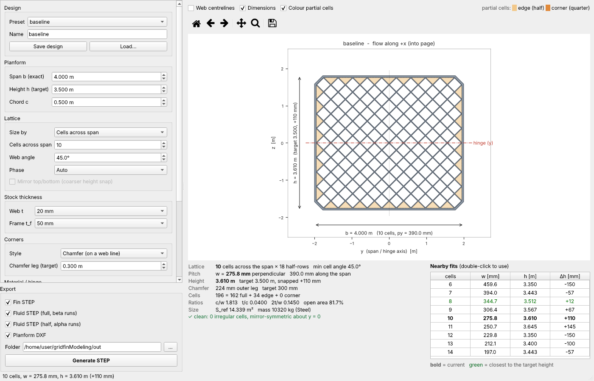
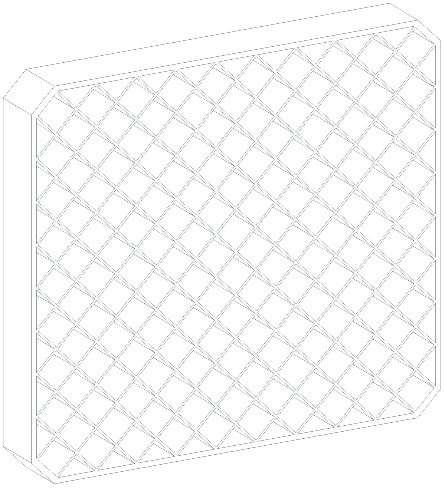

# gridfinModeling

[](https://github.com/AaronDoubert/gridfinModeling/actions/workflows/tests.yml)

Parametric grid-fin generator: a live 2D preview GUI, a lattice solver that always meets the frame cleanly, and STEP / DXF export for CFD (Fluent Meshing) and CAD comparison.



A step-by-step pass through the window, with the numbers each preset produces and
a look at the exported solid, is in **[docs/walkthrough.md](docs/walkthrough.md)**.
Notes on the interface itself are in [docs/gui-notes.md](docs/gui-notes.md).

## Install & run

```bash
pip install -r requirements.txt
python -m gridfin            # opens the GUI
```

On Linux you may also need Qt's system libraries (`libegl1 libgl1 libxkbcommon0`). Windows and macOS need nothing extra.

## Using the GUI

1. Pick a **preset**, or type in **span b**, **target height h** and **chord c**.
2. Size the lattice by **cells across span** (spin it up and down) or by a **target pitch w**.
3. Pick **web** and **frame** thickness from the stock-size dropdowns: metric plate in mm, imperial plate as inch fractions, or **Custom...**, which opens a millimetre box beside the dropdown.
4. Choose **Chamfer** or **Square** corners.
5. The preview updates as you type. The readout shows the snapped height, c/w, t/c, 2t/w, open area, S_ref and mass, and confirms the lattice is clean. Partial cells are coloured: edge half-cells and corner quarter-cells. Any irregular cell would show red, and by construction none should appear.
6. The **Nearby fits** table lists neighbouring cell counts and how far the height would move for each. The green row is the one closest to your target height. Double-click a row to use it.
7. **Generate STEP** writes the files to the chosen folder. **Save design** stores the inputs as `designs/<name>.json`, and saved designs appear in the preset dropdown.

The stock lists, materials and built-in presets are in `gridfin/presets.json`. Edit that file to add your own.

## Why the lattice never laps oddly

The webs are two line families at ±θ to the hinge axis (y), with perpendicular spacing *w*. Where two webs cross is a **node**. For a lattice that's mirror-symmetric about y = 0, the nodes always sit on the grid

```
y = j·py/2,   z = z0 + i·pz/2,   i ≡ j (mod 2)        py = w/sinθ,  pz = w/cosθ
```

A frame edge is clean when it runs exactly through a row or column of nodes. Then every web ends at a node, every edge cell is an exact half-cell triangle, and there are no slivers. On the inner face of the frame that means:

| | condition | what the solver does |
|---|---|---|
| span | `b_i = J · py` | **b is kept exact**: the pitch *w* is solved from the cell count J |
| height | `h_i = M · pz/2` | **h snaps** to the nearest clean value (shown live as Δh) |
| chamfer | the inner chamfer face lies **on a web line**, with legs `q·py/2 × q·pz/2` | q is picked to match your target leg. The lattice phase is chosen to allow it. All 4 corners are identical |

Chamfered fins use an even row count M, so the top and bottom match. For square corners you can tick *Mirror top/bottom* to get the same, at the cost of a coarser height snap. `tests/test_lattice.py` checks 540 combinations of cell count, thickness, angle and corner style. In every one there are zero irregular cells, the fin is exactly mirror-symmetric, and the height lands within half a snap step.

**Pitch convention:** *w* is the spacing measured perpendicular to the webs, the one in c/w. Measured along the span, the pitch is `py = w/sinθ`, which is 1.414·w at 45°. Use the same convention when you compare against Onshape.

## Outputs (per design)

| file | use |
|---|---|
| `<name>_fin.step` | solid fin |
| `<name>_fluid.step` | box minus fin, full model (β runs) |
| `<name>_fluid_half.step` | cut at the y = 0 mid-span plane (α runs only) |
| `<name>_planform.dxf` | 2D y-z section in metres, on layers FRAME_OUTER / FRAME_INNER / CELLS |
| `<name>.json` | inputs, solved lattice (J, M, w, h, phase, chamfer q) and dimensionless groups |

The fin is one planar face - the frame wire plus every cell as an inner wire -
extruded along the chord, so no 3D booleans are involved and the solid comes out
valid every time. An example set is recorded in
[docs/example-export/baseline.json](docs/example-export/baseline.json); the STEP
files themselves are not in the repository, because `python -m gridfin export`
rebuilds them in about three seconds.



Frame: x = chord / flow direction, y = span = hinge axis, z = height, with the origin at the planform centre and mid-chord. The α/β/Mach sweep needs no new geometry; you rotate the inlet velocity vector in Fluent instead. Face names don't survive STEP, so assign inlet, outlet, farfield, symmetry and wall by location in Fluent Meshing.

## Command line

```bash
python -m gridfin fits                                    # nearby cell counts vs height snap
python -m gridfin preview --set corner=square -o p.png    # PNG preview + metrics
python -m gridfin export designs/my_fin.json --out out/
python -m gridfin sweep --vary n_span=8,10,12 --vary t=0.010,0.020 --out out/
```

`--set KEY=VAL` overrides any parameter of `FinSpec` (`gridfin/lattice.py`).

## Layout

```
gridfin/lattice.py   solver (pure 2D, shapely) - FinSpec in, Layout out
gridfin/cad.py       CadQuery solids + STEP / DXF / JSON export
gridfin/gui.py       PySide6 window
gridfin/plot.py      matplotlib preview (GUI + CLI)
gridfin/presets.*    stock thicknesses, materials, built-in designs
tests/               pytest - lattice sweep, CAD export, GUI smoke
docs/                walkthrough, interface notes, screenshot script
.github/workflows/   CI: pytest on every push to main and every PR
```
