# Walkthrough

A pass through the GUI with the built-in presets, from opening the window to the
STEP files. Every screenshot here was taken from the real window; the numbers in
the text are the ones the solver prints for those presets, so you can check your
own run against them.

```bash
pip install -r requirements.txt
python -m gridfin
```

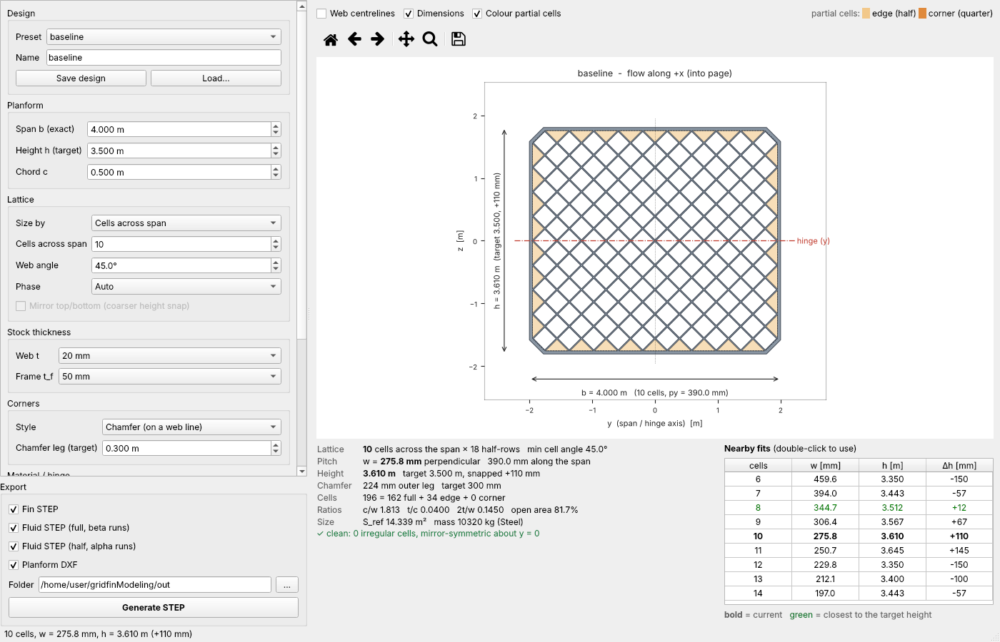

Left is the design, right is a live 2D planform preview with the solved numbers
under it. Nothing is modal and nothing needs an "apply" — the preview redraws
about an eighth of a second after you stop typing.

---

## 1. Start from a preset

The **Preset** dropdown holds the built-in designs from `gridfin/presets.json`,
followed by anything you have saved into `designs/`. Picking one fills in every
field below it, so it is the fastest way to get something on screen before you
start changing numbers.

The planform itself is three numbers:

| field | meaning |
|---|---|
| **Span b** | along the hinge axis. Held **exactly** — the solver never moves it |
| **Height h** | a **target**. It snaps to the nearest value the lattice can meet cleanly |
| **Chord c** | the extrusion depth along the flow direction. Sets `c/w` and the mass |

`b` is exact and `h` is a target because the two cannot both be free: once the
cell count across the span is an integer, the row pitch follows from it, and the
height has to land on a whole number of half-rows. The preview labels both, and
the height label always carries the snap: `h = 3.610 m (target 3.500, +110 mm)`.

## 2. Size the lattice

**Size by** chooses what drives the cell size, and the row underneath changes
to match:

- **Cells across span** — an integer count. The pitch is solved from it.
- **Target pitch w** — a length. The nearest whole cell count is solved from it,
  so the pitch you get back is usually a little off the one you asked for.

Seven cells across the span, 20 mm webs:

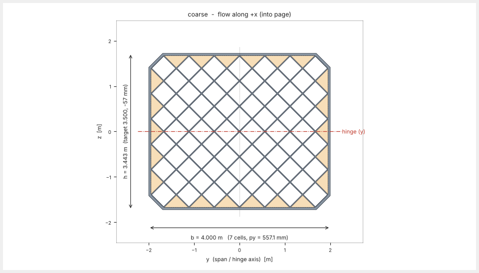

Fourteen cells, 12 mm webs:

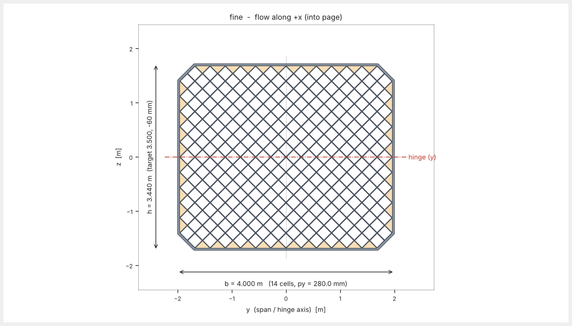

| | coarse (7) | baseline (10) | fine (14) |
|---|---|---|---|
| pitch *w* (perpendicular) | 394.0 mm | 275.8 mm | 198.0 mm |
| pitch along the span *py* | 557.1 mm | 390.0 mm | 280.0 mm |
| height after snapping | 3.443 m (−57) | 3.610 m (+110) | 3.440 m (−60) |
| cells | 94 | 196 | 354 |
| `c/w` | 1.269 | 1.813 | 2.525 |
| open area | 85.5 % | 81.7 % | 84.6 % |
| mass (steel) | 7751 kg | 10320 kg | 8208 kg |

Note that the mass does not climb with the cell count the way you might expect —
the fine preset uses thinner stock (12 mm web, 40 mm frame), which more than pays
for the extra webs.

## 3. Pick stock and corners

**Web t** and **Frame t_f** come from the stock lists in `presets.json`: metric
plate in millimetres, then imperial plate as inch fractions with the millimetre
equivalent in brackets. Pick **Custom...** and a millimetre box appears next to
the dropdown for anything not on the list.

**Corners** is either a chamfer that lies on a web line, or square. With a
chamfer the solver picks the nearest leg it can actually hit — ask for 300 mm on
the baseline and you get 224 mm, because the legal legs are whole steps of the
node grid. Square corners cost a few more partial cells (38 edge cells instead of
34) and a little more mass:

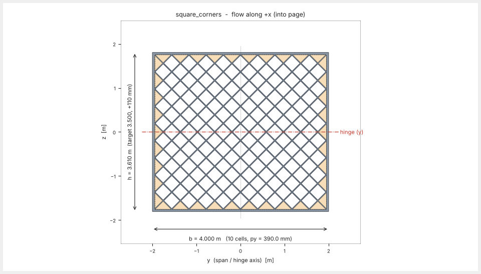

With square corners the **Mirror top/bottom** tick becomes available, which
forces the top and bottom rows to match at the cost of a coarser height snap.
It is always on for chamfered corners, otherwise the top and bottom chamfers
would differ by half a cell.

## 4. Read the numbers

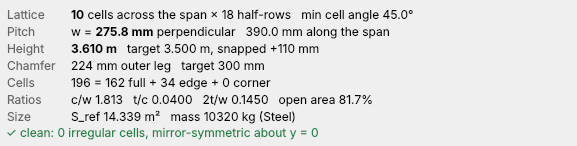

The last line is the one that matters: it confirms there are zero irregular
cells and that the planform is mirror-symmetric about `y = 0`, which is what the
half-model for α runs depends on. Partial cells are coloured in the preview —
pale orange for edge half-cells, darker orange for corner quarter-cells. An
irregular cell would appear in red, and by construction none should ever appear.

## 5. Let the fits table choose the height

Changing the cell count moves the height, so the useful question is not "which
cell count do I want" but "which cell count lands nearest the height I asked
for". That is what the table answers:

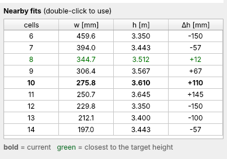

The bold row is where you are, the green row is whichever neighbouring count
lands closest to the target height. Here the target is 3.500 m: ten cells
overshoots by 110 mm, but eight cells is within 12 mm. Double-click a row to
jump to it.

## 6. Check the lattice

**Web centrelines** draws the two line families the solver works with. Every
crossing is a node, and a clean frame edge is one that runs exactly through a
row or column of them — which is why every edge cell comes out as an exact half
triangle:

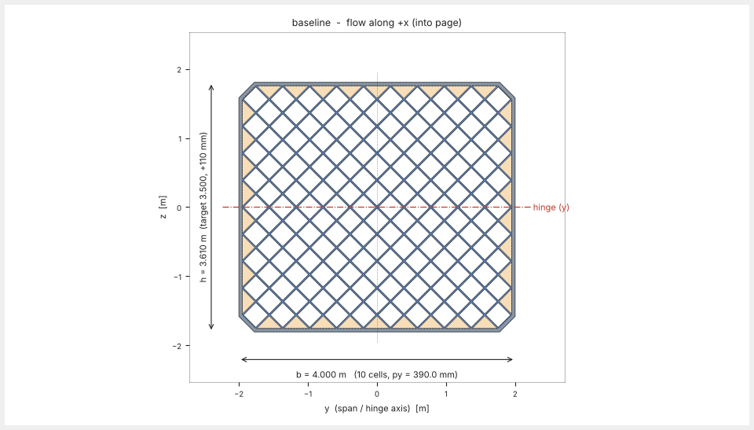

## 7. When nothing fits

Some combinations have no clean lattice at all — here the web thickness has been
pushed past the cell pitch. The preview says so rather than going blank, the
fits table empties so no stale row can be acted on, and **Generate STEP** greys
out:

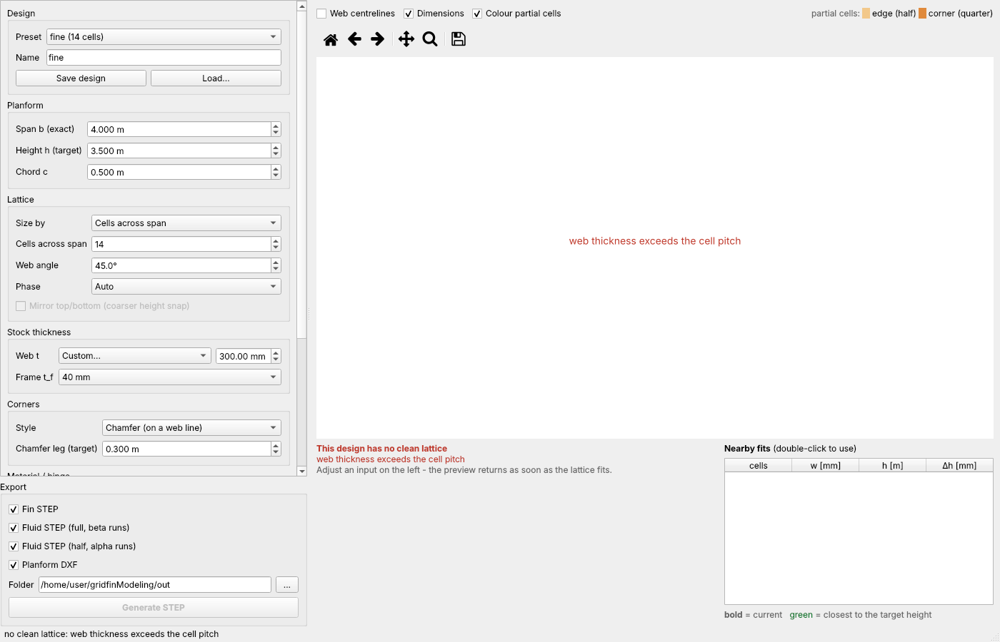

## 8. Generate

Tick what you need, set the folder and press **Generate STEP**. The build runs on
a background thread, so the window stays live and the status bar reports each
stage. The baseline design takes about three seconds:

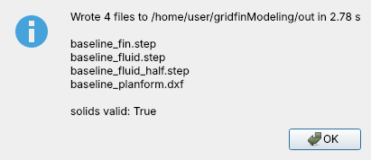

| file | size | use |
|---|---|---|
| `baseline_fin.step` | 2.9 MB | the solid fin |
| `baseline_fluid.step` | 2.9 MB | box minus fin, full model (β runs) |
| `baseline_fluid_half.step` | 1.5 MB | cut at `y = 0` (α runs only) |
| `baseline_planform.dxf` | 64 KB | 2D y-z section in metres, for CAD comparison |
| `baseline.json` | 2 KB | inputs, solved lattice and dimensionless groups |

A copy of that JSON is in [`example-export/baseline.json`](example-export/baseline.json)
so you can see the output format without running anything. The STEP files
themselves are not in the repository — they are 7 MB a set and
`python -m gridfin export` regenerates them in about three seconds.

## What comes out

The fin is built as one planar face — the frame wire plus every cell as an inner
wire — extruded along the chord, so there are no 3D booleans in the fin and the
solid comes out valid every time. For the baseline that is 760 faces and 2274
edges:

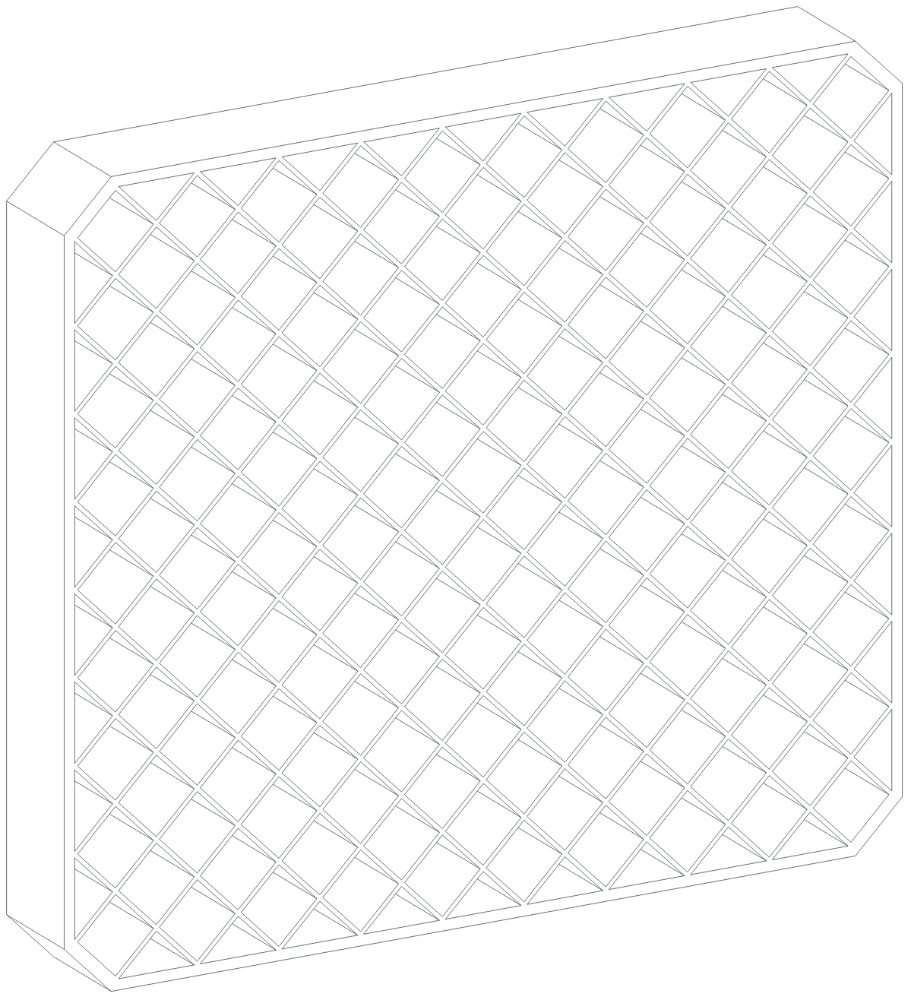

The corner is worth a closer look, because it is the part a hand-built lattice
usually gets wrong. The chamfer face lies exactly on a web line, the webs
meeting the frame all end on nodes, and the cells along the edges are exact
halves and quarters — no slivers anywhere along the join:

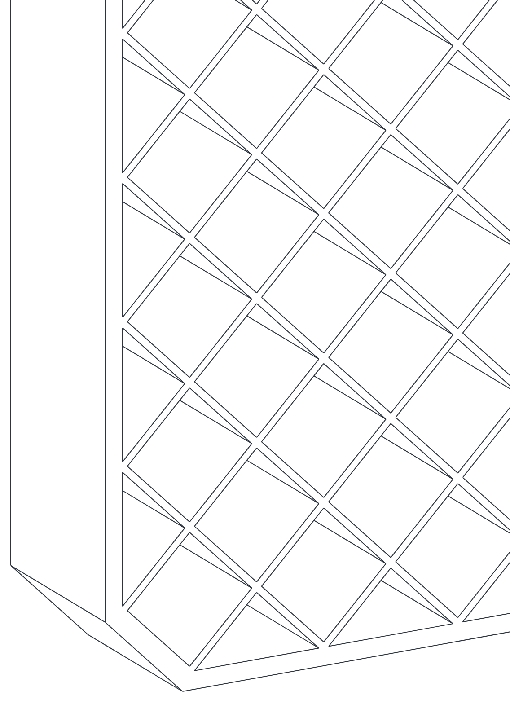

As a cross-check, the 2D metal area times the chord times the density gives
10320 kg, and the volume of the 3D solid times the density gives the same
10320 kg — the planform the preview draws and the solid that gets exported are
the same geometry.

---

Interface notes, and what is still rough, are in [`gui-notes.md`](gui-notes.md).
